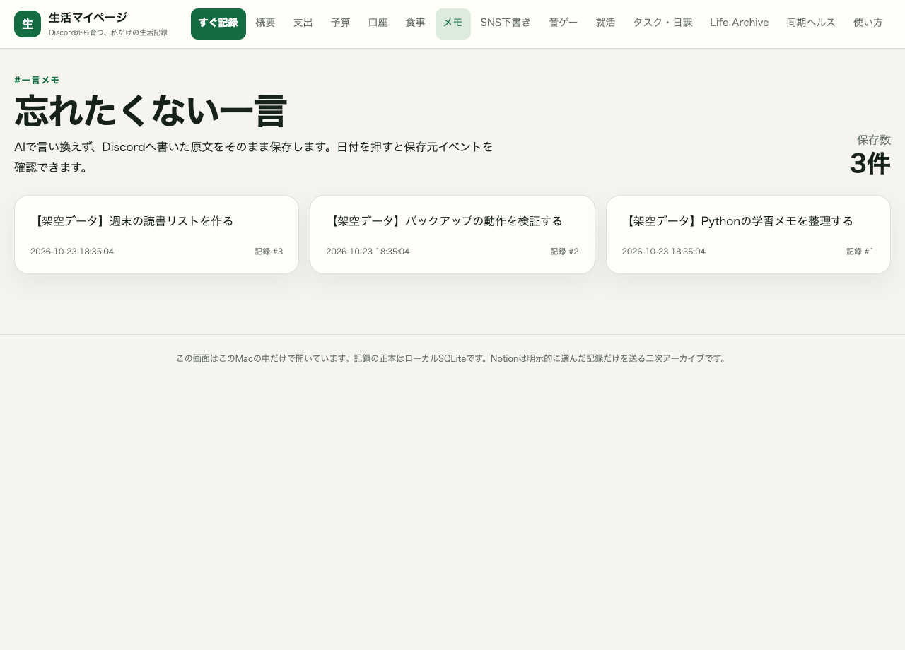
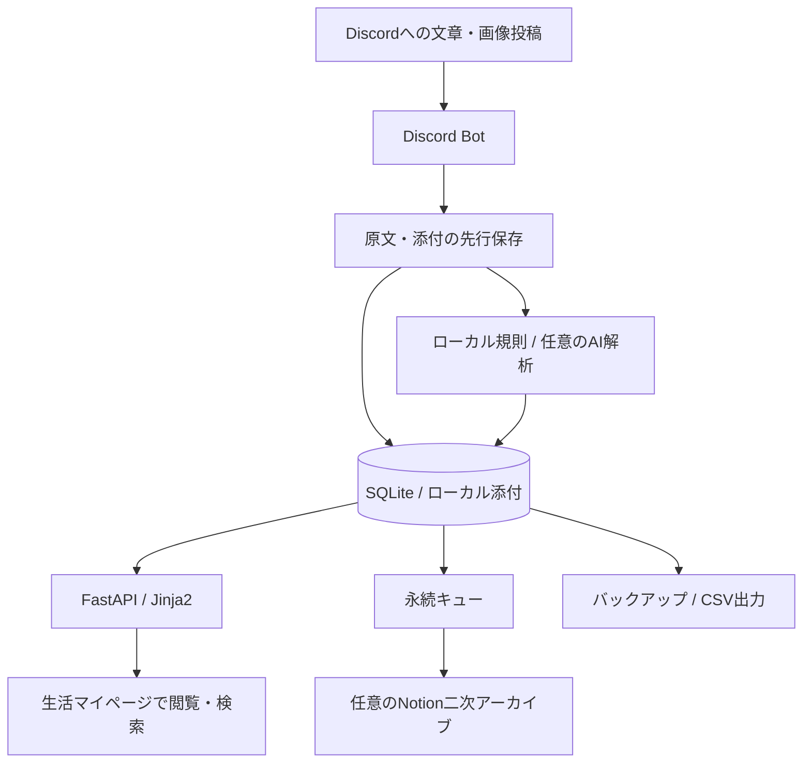

# LifeInbox

**Discordに送った日常の記録を保存・整理し、Web画面で振り返る個人用情報管理システムです。** Python / FastAPI / SQLite / Discord Botを組み合わせています。

> 個人開発のポートフォリオ用スナップショットです。開発には **OpenAI Codexを活用**しました。生成AIによる実装・修正・テスト支援を含み、実装・修正・テストに生成AIの支援を取り入れています。本リポジトリの整理・確認にもCodexを使用しています。

## 開発の背景と解決したかった課題

支出、食事、メモ、タスクなどの記録を、毎回決まったフォームへ入力する手間を減らすために開発しました。Discordへの短い文章や画像の投稿を入口とし、記録を後から検索・閲覧できる形に整理します。分類に失敗しても原文を失わないことを重視しています。

## 主要機能

| 機能 | 実装内容 |
| --- | --- |
| Discord入力 | 原文と添付を保存し、用途別の分類候補・コピーを扱うBot |
| 情報整理 | 支出、口座、食事、メモ、タスク、音ゲー記録等のモデル・処理 |
| Web閲覧 | ダッシュボード、一覧、検索・絞り込み、詳細画面 |
| データ保全 | Message IDによる重複防止、原文の先行保存、バックアップ・CSV出力 |
| Notion連携 | 永続キューを使った一方向の二次アーカイブ（任意） |
| AI支援 | OpenAIによる解析・分類の経路（任意）。ローカル規則も利用 |

実装と確認範囲の一覧は [機能・検証状況](docs/STATUS.md) を参照してください。

## 画面イメージ

以下は、公開用コピーのWeb画面に**架空の3件の記録だけ**を投入して撮影したものです。実利用データやアカウント情報は使用していません。



## 使用技術

| 役割 | 技術 |
| --- | --- |
| 言語 | Python 3.12以上 |
| Web | FastAPI、Uvicorn、Jinja2、HTML / CSS |
| 永続化 | SQLite、SQLAlchemy |
| Discord | discord.py |
| 設定・検証 | Pydantic、pydantic-settings、python-dotenv |
| 外部通信 | HTTPX、OpenAI SDK、任意のPlaywright |
| 開発支援 | OpenAI Codex、pytest、Ruff |

## システム構成



主なコードは `src/life_inbox/` にあります。`services.py` が入力処理、`discord_bot.py` がDiscord操作、`models.py` / `db.py` がデータ管理、`web.py` がWeb画面、`notion_*` が外部同期、`backup.py` がバックアップを担います。`tests/` にはMock・一時SQLiteを使うテストを含めています。

## 開発環境・セットアップ

```bash
git clone https://github.com/yuzu-rhythm/LifeInbox.git
cd LifeInbox
python3 -m venv .venv
source .venv/bin/activate
python -m pip install -e '.[dev]'
cp .env.example .env.local
```

Python 3.12以上が必要です。Private設定の場合、cloneにはアクセス権が必要です。アクセス権がない場合は、提供された公開用フォルダを使ってください。実際に使用した依存バージョンと確認環境は [検証記録](docs/VALIDATION.md) に記録します。

## 実行方法

### 外部アカウント不要のデモ

```bash
python examples/demo.py
```

ブラウザで `http://127.0.0.1:8876/memos` を開きます。専用の `data/portfolio-demo/` に架空データを作成し、通常の `data/app.db` は使用しません。Discord、OpenAI、Notionへの認証や接続は不要です。Ctrl+Cで停止します。

### 空のローカルWeb画面

```bash
python -m life_inbox init-db
python -m life_inbox web
```

Webは既定でループバックに限定されます。インターネット公開や複数利用者向けサービスとしての運用は、本ポートフォリオの確認対象に含めていません。

### Discord Bot（任意）

`.env.local` にBotトークン、許可するGuild / User、入力先・アーカイブ先Channel IDを設定して実行します。各IDは自分の検証用サーバーの値を使用してください。Bot権限とMessage Content Intentの設定も必要です。

```bash
python -m life_inbox check
python -m life_inbox bot
```

Botは設定に応じてDiscordへ投稿・コピー等を行います。公開用テストでは実サーバーへの送信を行っていません。OpenAI / Notion連携は既定で無効です。有効化には各サービス側の設定・認証情報が別途必要です。

## テスト・動作確認の実績

公開用コピーについて、pytest、Ruff、compileall、および架空データによるWeb画面の確認を実施しています。**正確な件数・結果・実行コマンドは [検証記録](docs/VALIDATION.md) を参照**してください。

```bash
python -m pytest -q
python -m ruff check src tests examples
python -m compileall -q src tests examples
```

過去の運用メモにある実サービス接続やCloud Run配備は、このコピーで再現していないため、今回の確認済み実績に含めていません。

## 開発で工夫した点

- **原文を先に保存**：分類や外部API処理の成否と、入力そのものの保存を分けています。
- **二重処理を抑制**：Discord Message IDや外部IDを使い、再送時の重複を防ぐ設計です。
- **外部連携の失敗に備える**：Notion連携は永続キュー・再試行で扱い、ローカルの記録を正本としています。
- **個人情報の扱い**：実データや認証情報をコードから分け、ローカル画面の接続先・添付配信先を制限しています。
- **切り分けやすい検証**：一時SQLiteとMockを用い、外部APIなしで異常系も確認できるようにしています。
- **生成AIを使った開発**：Codexの支援を受けながら実装・修正・検証を進めています。生成されたコードを含むため、実際のテスト結果と未確認範囲を記録しています。

## 今後の改善予定

- 依存関係の固定・更新手順とCIの整備
- 入力・閲覧フローと大きなモジュールの整理
- 外部サービス連携の検証環境と継続的な統合確認
- バックアップ復元・長時間運用・複数環境での確認拡充
- 外部サイト連携の利用条件や認証フローの継続確認

## 公開に関する資料

- [セキュリティ点検と除外方針](docs/SECURITY_REVIEW.md)
- [第三者ライブラリ・素材の扱い](THIRD_PARTY_NOTICES.md)
- [機能・検証状況](docs/STATUS.md)

本スナップショットには、オリジナルコード全体へのOSSライセンスを新規付与していません。一般的な再利用・再配布を許可する場合は、作者によるライセンス選択が必要です。第三者ライブラリの条件はそれぞれのライセンスに従います。
